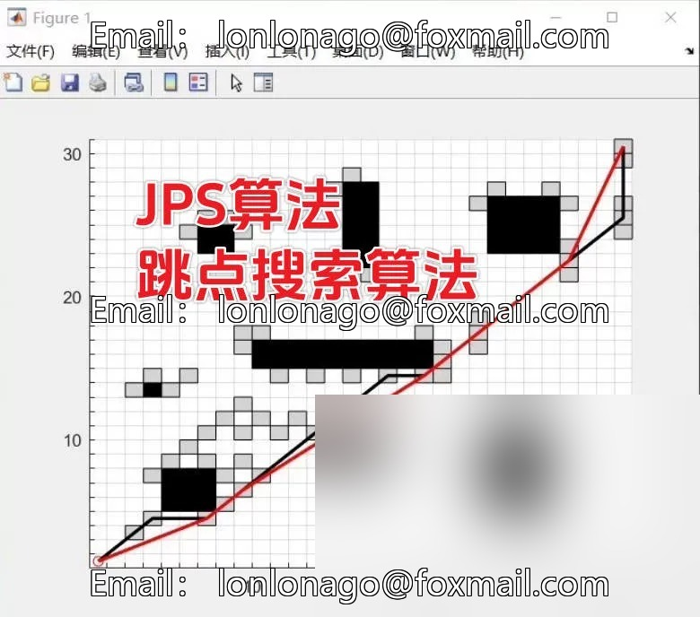

# JPS algorithm, jump-point search algorithm, including second-order path optimization, traditional intelligent A* algorithm

## Body

JPS algorithm, jumping-point search algorithm, which contains secondary path optimization, an improved algorithm based on the traditional intelligent A* algorithm.

MATLAB source code, with detailed code comments.

web-based shipment, can be directly photographed and shipped.

The algorithm covers jump-point search, quadratic path optimization and a traditional intelligent A* algorithm improvement, with detailed Matlab source code and comments; a network drive shipment service is available.

<!-- AI_ENRICHED -->

## Images

## Payment

Here is a pay link on Stripe ( https://buy.stripe.com/3cs8yP7sY87d0vu9AB ). Please contact me lonlonago@foxmail.com after funding $89, and I will send you a complete data files , thank you!

